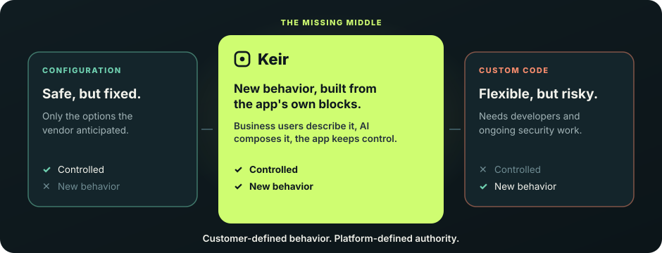

# Keir

Keir is a language, compiler and runtime for AI-assisted application customization. Business users describe the behavior they want, and an AI assistant turns their requests into extensions using the data and operations the application exposes.

The compiler checks each extension against the application's declared capabilities. At runtime, the application still controls permissions and carries out operations through its own services. Activated extensions run without further AI requests.

Start with [Keir rules by example](docs/customizations.md): compact logic sketches showing input checks, returned values, conditional actions and conditional lookup results.

## How it works

Keir has three parts: a **language**, a **compiler** and a **runtime**. Your application keeps everything else.

1. **The app publishes its model.** It defines the hooks where extensions can run, the input data and operations they can use, and the limits that apply.
2. **AI writes an extension in the Keir language.** The language combines declared data, supported expressions and operations from the model. There are no imports, loops, arbitrary code execution or direct network calls.
3. **The Keir compiler checks it against the model.** Operations must exist, types and data flow must match, and the extension must stay within the declared limits. Only a successfully compiled extension can run. Your app tests and approves the exact compiled extension that it later runs, with activation as a separate decision.
4. **The Keir runtime runs it inside the app.** When a hook fires, the runtime runs the activated extension within a budget and deadline and calls the app's operations. The app checks permissions and performs every effect through its own services. The Keir runtime makes no AI requests.

Your application also provides the authoring assistant, simulation, review and activation flow, and storage.

## See it in action

Daymark is a task-management demo built with Keir. Its tasks and task services belong to the demo application, not to Keir.

- [Short video overview (1.5 min)](https://youtu.be/1gO92NGgxmo).
- [Follow the Daymark walkthrough](docs/guided-tour.md): take a request through simulated checks, approval, activation and a saved result.
- [Run the Daymark demo](https://github.com/rore/keir-demo-app): get the code and local setup instructions.

## Build with Keir

Embed the Java or Node.js runtime in your application. Both run the same compiled extension format. Use the compiler when creating or changing an extension.

Start with [Getting started](docs/quickstart.md) to run and change one extension.

- [Install released packages](docs/installation.md) when embedding Keir without building this repository.
- [Integrate Keir](docs/embedding.md): expose application operations and call the compiler and runtime from your code.
- [Use a coding assistant for integration](docs/agents/host-integration-assistant.md).
- [Build an authoring assistant](docs/agents/extension-assistant.md): connect a customer conversation to compilation, simulation and review.

## Documentation

The [documentation index](docs/README.md) links the guides and references.

- [Keir specification](docs/specs/README.md): language, application model, compiler and runtime contracts. Use the [compatibility matrix](docs/specs/compiler-artifact.md#source-and-artifact-identity) when selecting packages.
- [Verification and testing](CONTRIBUTING.md#testing-principles): tested behavior and its evidence.
- [Contributing](CONTRIBUTING.md) and [roadmap](roadmap/scope.md).

Keir Core is licensed under the [Apache License 2.0](LICENSE); bundled components retain their [third-party notices](THIRD-PARTY.md). Packages are available through [GitHub Releases](https://github.com/rore/keir-core/releases).
