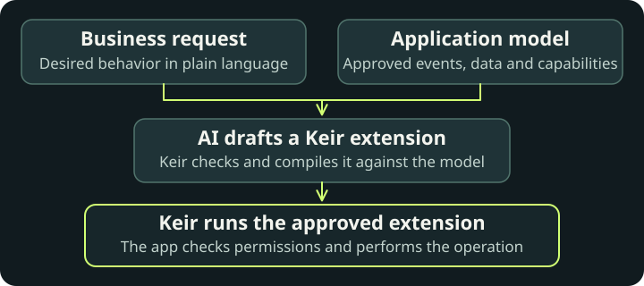

# Keir

Keir lets developers add AI-assisted customization to their applications. Users describe the business rules they need in plain language, and an AI assistant turns those requests into extensions built from capabilities the application exposes.

Different teams need different behavior from the same application: a follow-up task when work is completed, or a check that must pass before an operation can proceed. Supporting each variation as a new feature or setting puts the application team in the middle of every customization.

With Keir, developers define reusable building blocks. Users can then describe how those building blocks should work together without writing code.

Keir provides the extension language, compiler and runtime behind this workflow. AI helps author the extension. Once activated, the compiled extension runs without another AI request, through the application's own services and permission checks.

## From a business request to application behavior

A user of a task application asks: “When a task in the launch project is completed, create a follow-up task.”

The developer has exposed a task-completion event, a way to read task details, and an operation for creating tasks. The assistant uses those capabilities to write an extension that checks the completed task's project and requests a follow-up when it matches.

Keir's compiler checks the extension against the application's declared capabilities, types and limits. The application can then run simulated examples and present the results for review before activation.

After activation, the application invokes the compiled extension when a task is completed. Keir evaluates the rule, and the application checks permissions and performs any requested operation. The assistant does not need to interpret the request again each time.

## What you embed

Keir Core includes an extension language, a compiler that checks programs against the application's model, and Java and Node.js runtimes that execute the same compiled format.

Your application defines when extensions run and implements the operations they can call. It also provides the authoring assistant, review and activation flow, permissions and storage.

[Daymark](https://github.com/rore/keir-demo-app) demonstrates these pieces in a task application, from a user's request through review and activation to execution.

## What you can build today

- React to an event: read application data and conditionally request a change after an operation commits.
- Check a proposed operation: read relevant data and return an allow-or-deny decision that determines whether the application can continue its own validation.

An event extension may include at most one call that can change data, even if conditional. Pre-operation checks are read-only. Steps, calls and data size are bounded. See the [language reference](docs/specs/language.md) for supported expressions and limits.

## Start here

- [Run an example](docs/quickstart.md): run the follow-up extension, change its title and compile your version.
- [Understand the flow](docs/guided-tour.md): read the example's source and application model together.
- [Integrate Keir](docs/embedding.md): expose application operations and call the compiler and runtime from your code.
- [Build an authoring assistant](docs/agents/extension-assistant.md): connect a customer conversation to compilation, simulation and review.

## Documentation

The [documentation index](docs/README.md) links the guides and references.

- [Install released packages](docs/installation.md) without building this repository.
- [Use a coding assistant for integration](docs/agents/host-integration-assistant.md).
- [Keir specification](docs/specs/README.md): language, application model, compiler and runtime contracts. Use the [compatibility matrix](docs/specs/compiler-artifact.md#source-and-artifact-identity) when selecting packages.
- [Verification and testing](docs/testing.md): tested behavior and its evidence.
- [Contributing](CONTRIBUTING.md) and [roadmap](roadmap/scope.md).

Keir Core is licensed under the [Apache License 2.0](LICENSE); bundled components retain their [third-party notices](THIRD-PARTY.md). Packages are available through [GitHub Releases](https://github.com/rore/keir-core/releases).
