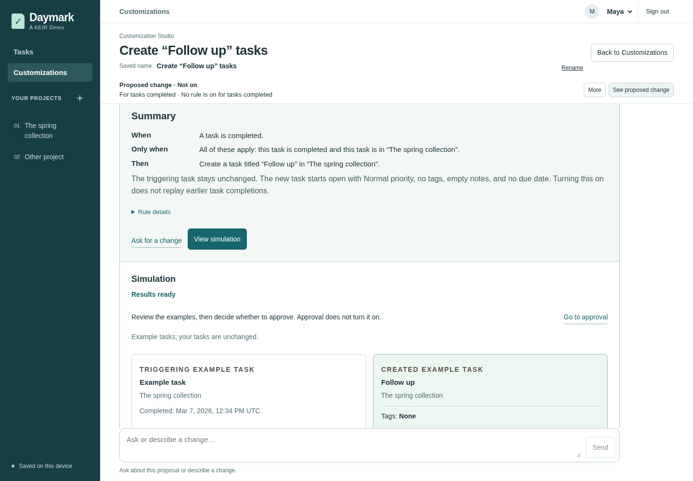
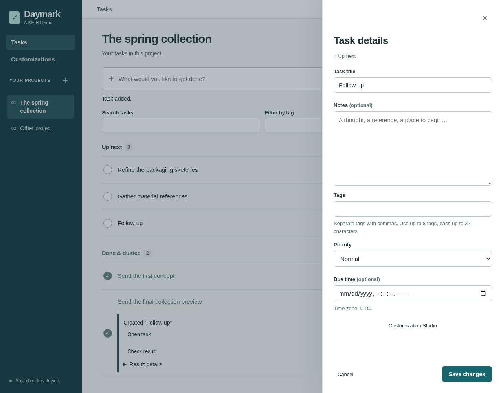

# How Keir works

Follow a request through a proposed change, simulated checks, approval, activation and a saved result. The screens below show Daymark, an example application built around Keir. Daymark supplies the assistant, screens, review and activation flow, and task services. Keir supplies the compiler and runtimes that check and execute the extension.

These are real application screenshots with fictional, disposable data. The assistant's replies were scripted by an offline test fixture; compilation, simulation, approval, activation and task saves were real. See [image provenance and license](images/daymark-walkthrough/README.md).

## 1. Describe and review the change

A user asks:

> When a task in this project is completed, create a follow-up.

The assistant turns the request into a proposed extension using the operations the application exposes. Keir's compiler checks it against the application's model. Daymark's **Summary** separates **When**, **Only when** and **Then**, so the user can review the proposed behavior and ask for a change before continuing. The full explanation remains available under **Rule details**.

*The application presents the checked behavior in terms the user can review. Keir supplies the compiler checks behind it.*

## 2. Check examples and approve the version

The application runs the compiled extension with example data and simulated service responses. The user compares expected and observed behavior, including cases where the extension should do nothing or cannot read the data it needs. These checks leave real saved tasks unchanged.

*Keir executes the extension; Daymark supplies the example data and presents the results. This example records the new task's title, project and tags, and explicitly says that its other details were not checked.*

The user reads the examples and their coverage limits, then chooses **Go to approval**. When the behavior is right, **Approve this change** records agreement to this exact version and its saved checks. Changing the extension requires new checks and approval.

## 3. Turn it on separately

Approval does not turn the extension on. Daymark shows **Approved · Not on yet**, with a separate **Turn on for tasks completed** action. Turning it on selects the approved version for future events; it does not replay earlier task completions.

*The application owns which approved version is active. Approval and activation are separate decisions.*

## 4. Run it and inspect the saved result

After the application saves a matching task completion, it invokes Keir's runtime with the selected compiled extension. The runtime calls the application's task service, which checks permissions and business rules before saving the follow-up. No further AI request is needed.

Daymark shows the customization's outcome separately from the original completion. The user can open the created task in the ordinary task editor and inspect the saved result.

*In this run, the follow-up is saved application data that the user can open and edit. It is no longer just a simulated result.*

## Build this into an application

[Run and change the small example](quickstart.md), then use the [embedding guide](embedding.md) to connect your own data and operations. The tour's task services belong to Daymark; Keir can use the operations another application exposes.
