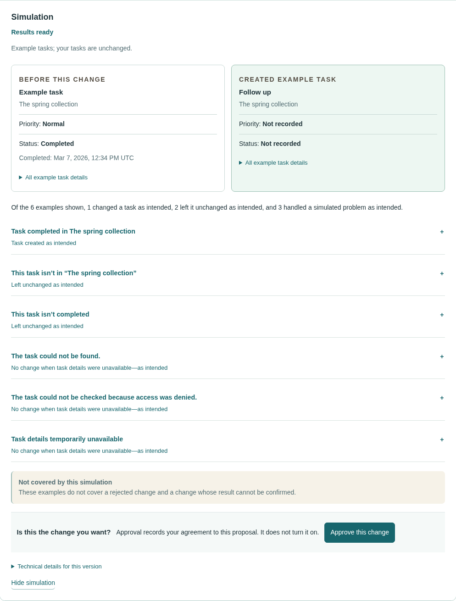
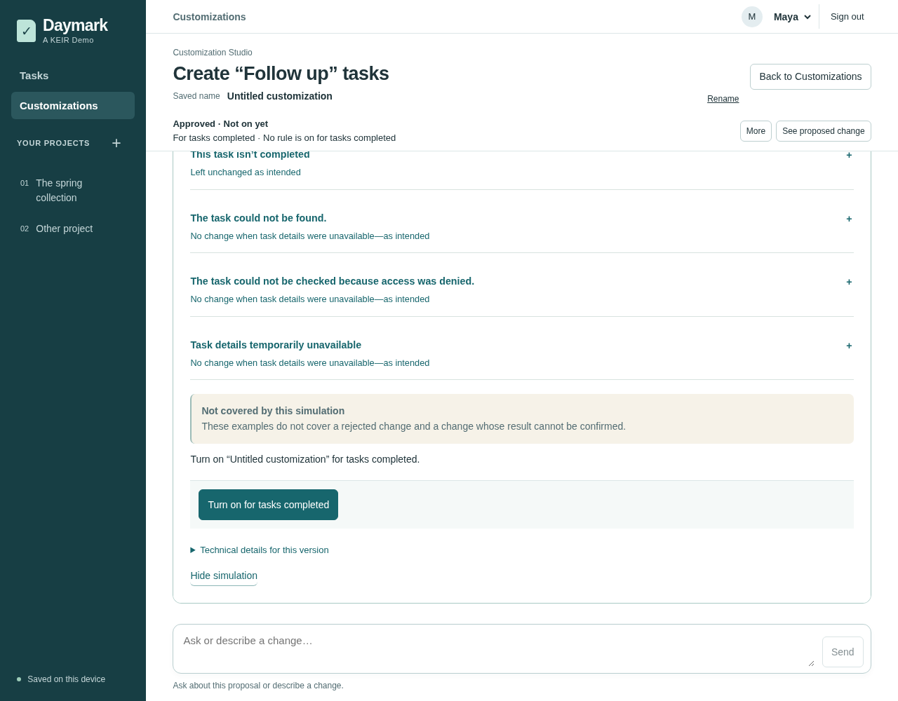

<a id="how-keir-works-a-guided-tour"></a>
<a id="what-keir-does"></a>
<a id="how-keir-works"></a>
# How Keir works

Follow a request through a proposed change, simulated checks, approval, activation and a saved result. The screens below show Daymark, an example application built around Keir. Daymark supplies the assistant, screens, review and activation flow, and task services. Keir supplies the compiler and runtimes that check and execute the extension.

These are real application screenshots with fictional, disposable data. The assistant's replies were scripted by an offline test fixture; compilation, simulation, approval, activation and task saves were real. See [image provenance and license](images/daymark-walkthrough/README.md).

## 1. Describe and review the change

A user asks:

> When a task in this project is completed, create a follow-up.

The assistant turns the request into a proposed extension using the operations the application exposes. Keir's compiler checks it against the application's model. The application shows the proposed behavior so the user can ask for a change before continuing.

## 2. Check examples and approve the version

The application runs the compiled extension with example data and simulated service responses. The user compares expected and observed behavior, including cases where the extension should do nothing or cannot read the data it needs. These checks leave real saved tasks unchanged.



*Keir executes the extension; Daymark supplies the example data and presents the results. The screen also states which situations these checks do not cover.*

When the behavior is right, **Approve this change** records agreement to this exact version and its saved checks. Changing the extension requires new checks and approval.

## 3. Turn it on separately

Approval does not turn the extension on. Daymark shows **Approved · Not on yet**, with a separate **Turn on for tasks completed** action. Turning it on selects the approved version for future events; it does not replay earlier task completions.



*The application owns which approved version is active. Approval and activation are separate decisions.*

## 4. Run it and inspect the saved result

After the application saves a matching task completion, it invokes Keir's runtime with the selected compiled extension. The runtime calls the application's task service, which checks permissions and business rules before saving the follow-up. No further AI request is needed.

Daymark shows the customization's outcome separately from the original completion. The user can open the created task in the ordinary task editor and inspect the saved result.


*In this run, the follow-up is saved application data that the user can open and edit. It is no longer just a simulated result.*

## Developer deep dive

The standalone example below is a separate, smaller implementation of the same idea, with its own application model and compiled extension.

An application exposes a model of the extensions it supports. An author writes an extension against that model. Keir compiles it, then an embedded runtime calls the application's operations. An assistant can help write the extension; execution uses the compiled artifact and does not require an AI request.

This section explains the [follow-up example](../examples/node-host/follow-up/). Use [Getting started](quickstart.md) to run and change it.

<a id="host-design-time"></a>
<a id="define-what-a-rule-can-do"></a>
### What the application exposes

The readable [domain capability model](../examples/node-host/follow-up/dcm.json) defines the available building blocks:

| Part | Meaning in this example |
| --- | --- |
| `TaskCompleted` | An event delivered after the application has committed task completion. It supplies a typed `taskId`. This extension cannot veto that completed operation. |
| `tasks.get` | A read operation that returns a task's project and status. |
| `tasks.create` | A write operation that accepts a project and title and returns the created task's ID. |
| Business types | `TaskId`, `ProjectId` and `UserId` distinguish identifiers. Enums restrict status values. |
| Protected parameters | The application supplies `actorId` and the original request key. The extension cannot choose another actor or replace that key. |
| Result | `FollowupResult` contains a status for the application to consume. |

The model describes an interface. The application implements the operations and enforces permissions and business constraints. See [define what the host exposes](embedding.md#1-define-what-the-host-exposes) when creating your own model.

<a id="customer-extension-design"></a>
<a id="write-and-review-a-rule"></a>
### What the extension chooses

Here are the steps and return value from [the source](../examples/node-host/follow-up/source.yaml). Its header selects the model and `TaskCompleted` entrypoint.

```yaml
steps:
  - id: eligibleProject
    let: {literal: 'project1', type: ProjectId}
  - id: source
    call: tasks.get
    args:
      taskId: {cel: input.taskId}
  - id: eligible
    let: {cel: 'source.status == "COMPLETED" && source.projectId == eligibleProject'}
  - id: created
    call: tasks.create
    when: eligible
    args:
      projectId: {cel: eligibleProject}
      title: {literal: 'Follow up'}
return:
  record:
    status: {cel: 'eligible ? "CREATED" : "NO_OP"'}
```

`eligibleProject` gives the selected identifier its declared `ProjectId` type. It does not grant access to that project. `source` reads the completed task. `eligible` checks its project and status. The final call runs only when that Boolean is true; its project and title are authored choices, while the actor remains under application control.

The compiler checks the source against the exact model, including types, available operations and call limits. It emits an artifact for either runtime. See [change the extension and compile it](quickstart.md#change-the-extension-and-compile-it) for the commands.

<a id="runtime"></a>
<a id="run-the-approved-rule"></a>
### What happens when it runs

The application binds its adapters, prepares the approved artifact and invokes it with the event input and trusted context. The runtime checks values and limits, evaluates the steps and calls those adapters. See [bind, prepare and run](embedding.md#3-bind-prepare-and-run).

Read the returned status and write evidence separately. `CREATED` is the extension's result; a `CONFIRMED` receipt records a confirmed write. `NONE` records no effect, while `UNKNOWN` means a write may have happened and the application must reconcile it. A result label alone is not proof of persistence.

Optional, if you have access to the Daymark repository: see its [model and extension catalog](https://github.com/rore/keir-demo-app/tree/main/extensions/task-effect), [host adapters](https://github.com/rore/keir-demo-app/blob/main/src/task-effects.mjs), [extension lifecycle](https://github.com/rore/keir-demo-app/blob/main/src/extension-lifecycle.mjs) and [authoring journey](https://github.com/rore/keir-demo-app/blob/main/docs/ai-authoring.md). The application supplies discovery, simulation, review and activation around Keir.
